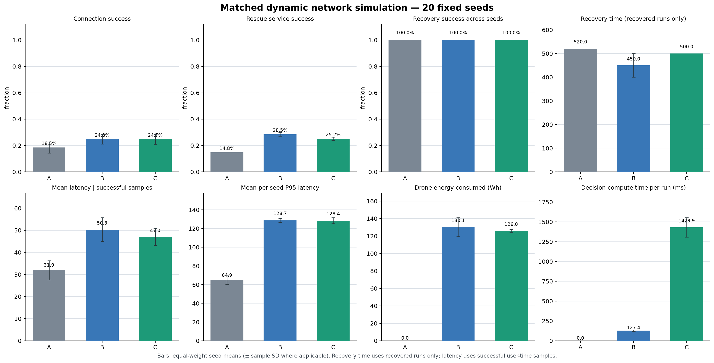
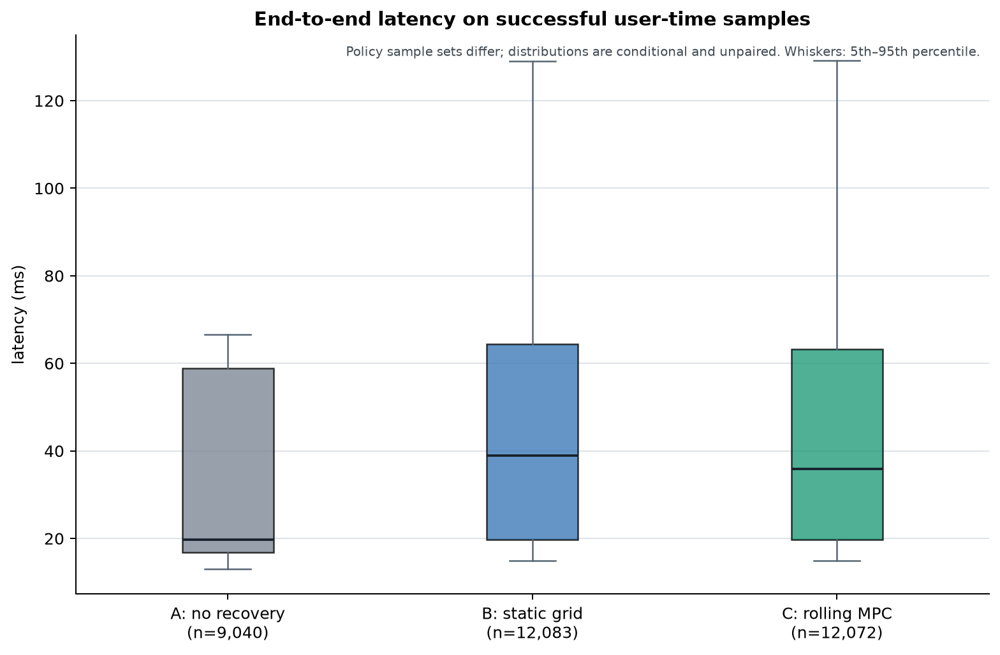

# 面向6G的低空应急网络智能自愈平台

2026 年 AI+6G 专项赛场景设计项目。使用 Python 实现可复现的城市应急通信网络抽象仿真，研究地面站故障、无人机中继和动态网络自愈调度。

> **研究范围：**本项目是面向 6G 研究的抽象仿真，不连接真实基站、核心网或无线电设备，不是 3GPP 一致性测试，也不构成真实网络性能报告。第二阶段调度器是确定性滚动时域搜索算法，没有训练机器学习模型，也没有经过真实网络验证。

## Windows 演示台

Windows 10/11 用户在解压后的项目根目录双击 `prepare_environment.cmd`，首次准备需要联网下载经过 SHA-256 校验的 Node.js 和 uv，并按锁文件安装 Python 与前端依赖。完成后双击 `start_demo.cmd`，浏览器会打开本次分配的本机地址。按启动窗口中的说明按 Q 或 Ctrl+C 停止本次启动的服务。运行日志保存在 `.runtime/logs/`。

演示页展示冻结的离线回放。Space 播放/暂停，左右方向键按 10 秒保存帧前进/后退；焦点在输入框、按钮、链接或滑块时快捷键不拦截控件操作。演示与研究页显示各自的数据来源和种子范围。更多环境说明、测量结果与限制见 [`delivery/ENVIRONMENT_AND_STARTUP.md`](delivery/ENVIRONMENT_AND_STARTUP.md)、[`delivery/PERFORMANCE.md`](delivery/PERFORMANCE.md) 和 [`delivery/KNOWN_LIMITATIONS.md`](delivery/KNOWN_LIMITATIONS.md)。

## 环境和快速运行

要求 Python 3.11+ 和 [uv](https://docs.astral.sh/uv/)。

```bash
uv sync --extra dev

# 第一阶段：种子 2026 的无恢复和静态网格规则策略对照
uv run lowalt6g run \
  --config configs/disaster_scenario.toml \
  --output results/phase1_benchmark.json

# 第二阶段：20 个固定种子的三策略动态对照，并生成 PNG/SVG 图表
uv run lowalt6g run-dynamic \
  --config configs/dynamic_scenario.toml \
  --output results/phase2_20_seed_results.json \
  --plots plots

# 自动化测试
uv run pytest -q
```

`run` 命令保留第一阶段接口。`run-dynamic` 的默认配置包含 20 个种子；完整逐种子指标、事件记录、实验配置和统计汇总写入 JSON，进度信息打印到标准错误。可使用 `--no-charts` 跳过绘图。

## 仿真场景和策略

基础灾后场景配置见 [`configs/disaster_scenario.toml`](configs/disaster_scenario.toml)：10 km × 10 km 城市、3 座地面基站（2 座初始故障）、32 名普通用户、8 名高优先级救援用户和 1 架无人机。仿真时长 600 秒、采样间隔 10 秒。二维欧氏距离、用户需求、链路容量、覆盖/接入/回传距离、传播和排队时延均由配置控制。

第二阶段独立配置见 [`configs/dynamic_scenario.toml`](configs/dynamic_scenario.toml)，不改变第一阶段 TOML 格式和命令。它在仿真过程中注入基站故障与恢复、业务负载变化、无人机回传中断与恢复，并以固定随机种子驱动用户随机游走和无人机电量模型。

动态对照组为：

| 代号 | 策略 | 说明 |
|---|---|---|
| A | 无无人机恢复 | 基站仍按场景事件故障或恢复，无人机不部署 |
| B | 第一阶段静态网格规则策略 | 初始时搜索网格位置一次，之后沿既定目标飞行，不重新选址 |
| C | 第二阶段滚动时域优化 | 按网络状态搜索有限时域动作序列，执行首个动作，并在状态变化时重新规划 |

第二阶段调度器诊断故障基站、失联用户、未覆盖用户、容量阻塞、救援用户失联、拥塞资源和无人机回传状态。候选动作须满足城市边界、飞行速度、接入/回传距离、容量、电池保留量和返航能量约束。算法是带约束的有限时域 beam search，不是经过训练的 AI 模型；算法细节、权重、统计口径和限制见 [`PHASE2_REPORT.md`](docs/phases/PHASE2_REPORT.md)。

## 第二阶段固定种子实验

以下数据来自 2026-10-18 的实际运行，配置种子为 2026–2045，三种策略对每个种子使用相同的预生成用户移动和事件轨迹。成功率是全时域用户—时刻平均值；时延仅在成功连接的用户—时刻上统计。恢复时间是首次同时接通全部救援用户的采样时刻。

| 指标 | A 无无人机恢复 | B 静态网格 | C 滚动优化 |
|---|---:|---:|---:|
| 用户连接成功率（跨种子均值） | 18.525% | 24.760% | 24.738% |
| 救援用户服务成功率（跨种子均值） | 14.754% | 28.504% | 25.195% |
| 恢复成功 | 20/20 | 20/20 | 20/20 |
| 已恢复场景平均恢复时间 | 520 s | 450 s | 500 s |
| 成功样本 pooled 平均时延 | 31.284 ms | 49.940 ms | 46.610 ms |
| pooled P95 时延 | 66.524 ms | 129.035 ms | 129.182 ms |
| 无人机平均能耗 | 0 Wh | 130.139 Wh | 125.967 Wh |
| 每个 600 秒运行的算法决策总耗时 | 0 ms | 127.424 ms | 1,429.905 ms |

当前实验中，滚动优化相对第一阶段静态策略平均节省约 4.17 Wh，pooled 平均时延低约 3.33 ms，用户连接率接近；但救援用户服务率低约 3.31 个百分点，平均恢复晚 50 秒，P95 时延略高，决策计算也明显更耗时。因此目前不能宣称第二阶段算法在核心服务指标上全面优于第一阶段。完整实际数值及每个种子的日志见 [`results/phase2_20_seed_results.json`](results/phase2_20_seed_results.json)。





## 结果解释和复现注意事项

- 动态场景中基站会按事件恢复，因此 A 组也可能在没有无人机的条件下恢复。第二阶段 20 个种子均在 600 秒内达到恢复定义，不代表永久断站时也能恢复。
- 恢复时间只对达到“所有救援用户同时连接”的运行求均值；未恢复运行保留为 `null`，不以仿真超时替代。当前 20 个种子没有未恢复样本。
- 各策略成功连接的用户集合可能不同，平均时延和 P95 时延是各自成功样本上的条件统计，不能作同一用户集合的配对比较。
- 算法计算耗时用 `perf_counter` 实测，和仿真时间分开记录；会受 CPU、Python 环境和系统负载影响。相同种子可复现网络轨迹及网络指标，但墙钟计算时间不保证逐字节相同。
- 配置摘要 SHA-256、随机种子、每个种子的世界轨迹 SHA-256 和事件时间戳写入 JSON，支持核验输入和结果来源。

## 项目结构

```text
configs/                         第一阶段和动态实验 TOML 配置
src/lowalt6g/config.py           配置读取与校验
src/lowalt6g/scenario.py         可复现场景生成
src/lowalt6g/engine.py           距离、覆盖、容量分配和时延模型
src/lowalt6g/policies.py         第一阶段规则网格策略
src/lowalt6g/dynamic_config.py   第二阶段独立动态配置
src/lowalt6g/dynamic_world.py    同种子共享事件和移动轨迹
src/lowalt6g/dynamic_simulation.py  动态仿真、三策略对照和指标
src/lowalt6g/optimizer.py        诊断和滚动时域 beam search 调度
src/lowalt6g/experiment.py       多种子汇总、配对指标和统计口径
src/lowalt6g/charts.py           PNG/SVG 对照图表
src/lowalt6g/cli.py              命令行入口
tests/                           第一、二阶段自动化测试
results/phase1_benchmark.json    保留的第一阶段基准结果
results/phase2_20_seed_results.json  第二阶段 20 种子实际结果
plots/                           第二阶段 PNG/SVG 图表
docs/phases/PHASE1_REPORT.md      第一阶段报告
docs/phases/PHASE2_REPORT.md      第二阶段算法、实验和限制报告
docs/phases/DEVELOPMENT_LOG_PHASE2.md  第二阶段审计式开发记录
frontend/                         第三阶段 React + TypeScript 应用
src/lowalt6g/api.py              第三阶段只读 FastAPI 数据接口
results/phase3_replay_seed_2026.json  仿真引擎生成的 61 帧三策略离线回放
docs/phases/PHASE3_REPORT.md      第三阶段页面、集成、验证和限制报告
docs/phases/PHASE4_REPORT.md      第四阶段算法、科研验证和结果限制
docs/phases/DEVELOPMENT_LOG_PHASE4.md  第四阶段审计及开发种子迭代记录
results/phase4_development_3000_3004.json  五个开发种子的逐次结果
results/phase4_validation_4000_4019.json   二十个留出种子的原始结果和统计
plots/phase4_validation_*         第四阶段 PNG/SVG 指标及条件时延图
```

## 当前技术限制

仿真采用二维城市平面和简化链路模型，不包含三维无人机高度、3GPP 信道、建筑遮挡、多径、无线干扰、频谱调度、协议栈、真实 RAN/核心网、切换过程或现场设备校准。用户按独立随机游走移动，业务负载按全网倍率变化；无人机续航按简化飞行/悬停/中继功耗计算，不含风场、充电和电池老化。滚动优化在有限预测期内冻结当前拓扑、位置和流量，不预测未来故障或随机移动。进入真实网络或比赛结论前，仍需补充更高保真模型、场景校准、算法消融和独立数据验证。

## 第三阶段：数字孪生前端

前端位于 [`frontend/`](frontend/)，包括项目首页、数字孪生指挥中心、滚动优化决策页和三策略实验室。页面读取后端提供的真实 JSON；指挥中心与决策页回放种子 2026 的三策略 61 帧状态。暂停、继续、倍速、拖动时间、逐步跳转和策略切换均在本地回放状态上执行。实验室展示已保存的 20 种子基准，不会重新计算或修改该结果文件。

回放产物由仿真引擎重新运行生成，包含世界轨迹 SHA-256、基站健康状态、用户位置/连接/时延、无人机位置/电量/回传状态、服务链路、诊断、调度输出和仿真事件：[`results/phase3_replay_seed_2026.json`](results/phase3_replay_seed_2026.json)。FastAPI 是只读接口；它目前服务预计算离线数据，不提供 WebSocket 实时网络数据，也不连接真实无线网络。

### 启动前端和 API

Windows 10/11 用户应使用项目根目录的 `prepare_environment.cmd` 与 `start_demo.cmd`。启动脚本会组合启动当前兼容 API `lowalt6g.phase6_api:app` 和前端，选择空闲本机端口，检查固定 Phase 6 数据并打印实际访问地址。无需重新生成或覆盖冻结回放。完整操作及五分钟流程见 [`delivery/ENVIRONMENT_AND_STARTUP.md`](delivery/ENVIRONMENT_AND_STARTUP.md) 和 [`submission/final/DEMO_GUIDE.md`](submission/final/DEMO_GUIDE.md)。

开发时也可在环境准备后分开运行 API 和 Vite；API 使用 `lowalt6g.phase6_api:app`，Vite 代理目标通过 `LOWALT6G_API_TARGET` 配置。手动开发服务不改变上述一键启动器的动态端口行为。运行 `npm run build` 可进行 TypeScript 检查并生成生产包。

界面使用轻量 SVG 城市平面图而非 WebGL 三维场景；ECharts 实验图表按需加载。支持系统减少动态效果偏好。主视觉和二维传播模型不能代表真实城市地理、建筑遮挡或真实 6G 网络测试。
## 第四阶段：算法审计与救援优先调度验证

第四阶段新增 D 词典序救援优先滚动候选搜索、恢复成功 Wilson 区间和 20 个独立留出种子。运行：

```bash
uv run lowalt6g run-phase4 --config configs/dynamic_scenario.toml
```

默认开发种子为 3000–3004，验证种子为 4000–4019；输出到 `results/phase4_development_3000_3004.json`、`results/phase4_validation_4000_4019.json` 和 `plots/phase4_validation_*`。Phase 4 JSON schema 为 2.1，保留逐种子事件、原始成功连接时延样本、配置哈希、统计区间和配对差。Phase 2 `run-dynamic` 仍输出 schema 2.0，第三阶段 API 和 A/B/C 回放格式保持不变。

留出实验没有证明 D 或 C 在救援服务和首次恢复时间上超过 B：D 救援服务率 24.91%，B 为 28.71%；首次恢复均值分别为 501 秒和 446.5 秒。D 的能耗较低，但计算耗时明显增加。完整审计、算法约束、区间、失败分析和局限见 [`PHASE4_REPORT.md`](docs/phases/PHASE4_REPORT.md)，开发过程见 [`DEVELOPMENT_LOG_PHASE4.md`](docs/phases/DEVELOPMENT_LOG_PHASE4.md)。项目依旧是抽象的 6G 研究仿真，不是实网测试。

## 第五阶段：多灾害自主自愈验证

第五阶段新增四类场景、统一的无人机执行安全约束、静态网格约束对照 B′、滚动时域策略 C 和词典序救援优先策略 D。完整方法、数据和适用边界见 [PHASE5_REPORT.md](docs/phases/PHASE5_REPORT.md)。

运行冻结方案的验证集前，先运行开发集；验证阶段会检查算法和场景配置是否与冻结清单哈希一致：

    uv run lowalt6g run-phase5 --phase development
    uv run lowalt6g run-phase5 --phase validation
    uv run python scripts/phase5_audit.py

留出逐种子结果位于 results/phase5_validation_*.json，汇总及 95% 区间位于 results/phase5_validation_summary.json，故障/恢复事件索引位于 results/phase5_failure_cases.json，安全和数据一致性核验位于 results/phase5_integrity_audit.json。对照图位于 plots/phase5_*.png 和 plots/phase5_*.svg。历史 Phase 2–4 结果和早期 Phase 5 试验均保留。

API 新增 GET /api/experiments/phase5 和 GET /api/experiments/phase5/{scenario_id}；原回放和实验接口保持不变。所有结果都是基于抽象模型的可复现仿真，不代表真实 6G 实网或飞行器测试。


## GitHub review package

The complete package, including all raw experimental records, is attached to the [GitHub Releases](https://github.com/DorianChn/low-altitude-emergency-network-self-healing-6g/releases). See [GITHUB_PUBLICATION.md](docs/phases/GITHUB_PUBLICATION.md) and [AUTHORS.md](AUTHORS.md).
