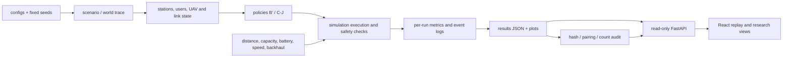

# 最终技术架构与实现边界

## 分层与实际代码

| 层 | 主要代码 | 职责/边界 |
|---|---|---|
| 场景、配置和业务实体 | `src/lowalt6g/config.py`、`dynamic_config.py`、`scenario.py`、`models.py` | 读取静态/动态场景，建立站点、用户、无人机及配置对象 |
| 网络和链路 | `engine.py`、`radio_link.py`、`phase14_radio.py` | 距离/容量分配及可选链路预算抽象；不模拟完整城市无线传播或真实干扰 |
| 控制策略 | `policies.py`、`dynamic_simulation.py`、`phase8_d_optimizer.py`、`phase9_strategy_e.py`、`multi_uav.py`、`phase11_algorithms.py` | A–J 规则、候选优化及资源分配策略；未训练为机器学习模型 |
| 执行和安全约束 | `simulation.py`、`dynamic_simulation.py`、`multi_uav_simulation.py`、`energy_budget.py` | 执行策略动作，应用移动、电量、容量和返航等软件约束 |
| 实验和统计 | `experiment.py`、`phase8_experiments.py`、`phase9_experiments.py`、`phase10_experiments.py`、`phase11_experiments.py`、`phase14_experiments.py`、`charts.py` | 运行种子、配对策略、导出统计和图表 |
| 校准/测量状态 | `phase15_data.py`、`phase15_calibration.py`、`phase16_measurement.py`、`phase17_hil.py` | 公开数据导入、设备证据门控、软件闭环；物理采集/HIL 未执行 |
| API 与回放 | `api.py`、`phase6_api.py`、`phase6_demo.py` | 只读实验摘要、离线回放和阶段证据 API；不提供 live telemetry |
| 展示与交互 | `frontend/src/ResearchPage.tsx`、`Phase6DemoPage.tsx`、`Phase17ResearchSection.tsx`、`Phase18ResearchSection.tsx` | React 页面显示保存数据、回放帧、审计状态；二维可视化不等于物理网络孪生 |
| 测试与完整性 | `tests/`、`frontend/src/test/`、`frontend/e2e/`、`scripts/run_phase18_final_audit.py` | 软件契约、回归、浏览器、散列和实验结构审计 |

## 关键数据流

`configs/` + 固定随机种子 → 场景/世界轨迹 → 网络状态与可观察特征 → 策略生成动作 → 仿真执行层检查动作并更新链路/资源/电量 → 指标和逐种子 JSON → SHA-256/统计审计 → FastAPI 只读提供 → React 把已存帧和摘要呈现给用户。

策略只能读取其仿真控制接口公开的当前/历史状态；环境内部的未来事件安排不能作为可部署预测输入。运行时安全约束由仿真环境实施，而不由可视化页面替代。已冻结历史结果与 Phase 18 新文件分别保存在各原阶段目录和 `results/phase18/`。

## 不属于系统的能力

没有运营商网络连接、物理基站适配、无人机飞控、射频发射控制、现场测量驱动或真实 6G 标准符合性验证。`phase17_hil.py` 的软件闭环不是硬件在环。
