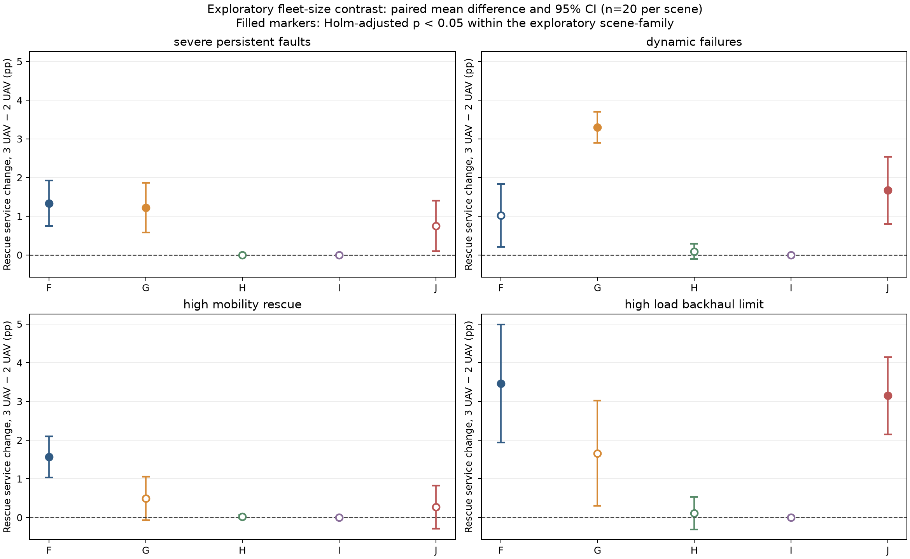

# 第十一阶段报告：算法基线扩展与公平对比

**项目：** 面向6G的低空应急网络智能自愈平台  
**分支：** `phase11-baseline-benchmark`  
**确认集：** 4类场景 × 每类20个留出种子 × 11种策略配置  
**研究范围：** 单无人机B′参考，多无人机F/G/H/I/J对比；抽象仿真，不是真实6G或真实无人机外场测试。

## 结论摘要

本阶段完成了基线审计、新增H/I/J三种独立基线、12个开发种子（132次运行）和80个确认种子（880次运行）。确认集内每个场景和种子的11个配置共用同一条环境轨迹；验证数据在策略参数冻结后运行。没有发现越界、超速、最小间距、共享容量、用户重复计数或决策超时违规。

实验没有显示一个策略在四类灾害和两种机队规模下全面占优：

- G相对F的救援服务优势具有场景条件。3机动态故障下G高2.38个百分点，配对差异经Holm校正后仍显著；3机高负载回传受限场景则F高3.99个百分点，校正后仍显著。其余F/G场景差异未达到预设校正后的显著性门槛。
- H平均规划开销较低，但救援服务率低于G，四场景、两种规模的G−H差异均经校正显著。它以覆盖效果为代价换取低计算开销，不能称为接近G的服务效果。
- I只做固定位置的用户—资源分配，不移动无人机。它有助于研究分配子问题，但确认集没有一次完整救援恢复；三类场景救援服务率为0，动态故障为10.78%。这项结果说明分配器不能替代位置规划，不代表该子问题无价值。
- J在相同G候选短名单上做受限联合束搜索。2机结果与G很接近；3机动态场景救援服务比G低1.63个百分点且经校正显著。J在多数场景计算耗时低于G，但并非每种规模/场景都保持该关系。
- 增至3机的收益依赖算法和场景。探索性同种子配对分析中，F在严重故障、移动和高负载场景的救援服务增益经校正显著；G只在严重故障和动态故障显著；H/I没有显著救援增益；J在动态故障和高负载显著。此分析是补充探索性分析，不纳入冻结的主要假设族。

## 一、审计结果与比较边界

### 历史数据完整性

Phase10冻结协议核验通过：15项Phase10受保护产物无哈希差异；Phase10确认集仍为80条轨迹、400次策略运行，匹配轨迹哈希差异为0。Phase11协议记录的Phase1–9受保护哈希检查通过。Phase10及之前的报告、实验JSON和冻结清单均未由本阶段改写。

Phase11开发集为12个种子、132次策略运行，耗时38.043秒。确认集耗时225.341秒。确认策略、参数、随机种子、统计计划和算法说明已在确认集启动前冻结。

### 已有策略的实际机制

| 策略 | 实际决策逻辑 | 主要比较限制 |
|---|---|---|
| B′ | Phase10单机静态网格选址，沿用公共运行时安全与容量模型 | 1架无人机，与双/三机结果的差异同时包含机队规模差异；旧策略只保留一次规划计时，详细资源利用率/候选评估计数未完整埋点 |
| F | 每架无人机根据当前可观察状态独立排序单机候选位置；共享安全仲裁和共享网络分配器解决间距与资源冲突 | 候选推荐是逐机、非联合的 |
| G | 使用与F相同状态信息和候选生成器，把每架无人机短名单的组合交给共享网络评估器；按救援连接、恢复可达性、普通连接、时延、能耗、移动和切换词典序比较 | 全排列仅限候选短名单，不能据此称为全局最优；与F不是等工作量搜索 |
| H | 按无人机ID顺序逐架选址；每次选址后重新评估唯一新增救援服务，再更新共享容量预算 | 贪心顺序会产生次优组合；减少计算不等于保持G的服务质量 |
| I | 无人机保持当前/预置位置；对整用户单路径进行救援优先的容量约束分配，使用有界beam search | 只研究用户分配，不是轨迹规划；不可与F/G/H/J作为完整自愈策略作等价优劣排名 |
| J | 复用G逐机排序出的完全相同候选短名单、目标函数、状态和安全规则；用宽度16的部分联合束搜索 | 与G搜索空间结构相同但遍历工作不同；G统计最多512个完整可行组合，J统计至多512个可行部分状态，不能宣称FLOPs相等 |

F/G/H/J共用相同的通信状态评估器：用户每个采样时刻只分配一条完整路径；每个健康基站的总容量由全机队共享；无人机各自受接入与回传容量限制；端到端路径必须满足健康基站/回传、距离、速度、城市边界、电量储备、返航预算和0.75 km机间距约束。无线同频干扰未模拟。I复用相同的路径容量规则，但位置固定。

规划计算耗时从策略规划器开始，到规划器返回为止；不含网络仿真执行和移动。总耗时为每次运行规划调用墙钟耗时之和，单次耗时为该次运行中调用均值。B′使用Phase10适配路径的旧规划计时，只发生一次规划，因此其耗时不能视为与多次重规划F–J完全同口径。候选评估数和搜索节点数是算法内部计数，不代表硬件FLOPs。

## 二、算法目标与实验控制

### H：边际救援覆盖贪心

按无人机确定性ID顺序，枚举可行位置。对每个候选位置用共享资源分配器评估此前已选位置之后的新增唯一救援用户服务数；优先取救援增量，其次总连接增量，再比较能耗/航程、时延、目标改变与坐标稳定顺序。每选完一架就冻结其意向并更新共享容量，不为无人机复制基站容量。H可以报告无可行候选并保持位置。

### I：固定位置用户—资源分配

把每个用户的需求作为整体，枚举健康基站直连或固定无人机中继路径；每位用户只能分配至一条完整路径。路径占用共享基站容量，并在中继时占用对应无人机接入及该机回传预算。先按救援身份、优先级分层，再考虑总连接与路径时延。受宽度64、每次最多6000个状态扩展及2秒截止时间限制；未处理用户保持未服务，超时时返回安全的部分分配。它不是标准单容量边的最小费用最大流，而是耦合多个资源池、用户需求不可拆分的有界广义匹配近似。

### J：预算受限联合束搜索

候选空间直接复用G每架无人机的前6个候选，机间间距0.75 km，重新规划间隔60秒，决策墙钟预算2秒。G保留原实现，至多512个完整可行候选组合；J使用宽度16的确定性beam，至多512个可行部分状态评估，耗时到限或候选耗尽后返回已有安全计划。J与G的候选集和目标定义相同，搜索过程/工作量不同，所以在结果中同时报告墙钟时间、节点/候选数，不把它们说成算力完全等价。

### 场景、种子和配对

- 四类场景直接复用Phase5配置：严重持续故障、动态故障、高移动救援、高负载及回传受限；每次仿真600秒、10秒采样。
- 开发集每场景3个种子，共12个、132次运行；只作算法修正和实现检查。
- 确认集每场景20个未参与开发的种子，共80条灾害轨迹、880次运行（80 × 11）。种子为95100–95119、95200–95219、95300–95319、95400–95419，按场景对应。
- 同一场景/种子的11种策略使用一个预生成 `DynamicWorldTrace`；确认集80组中轨迹哈希不匹配为0。无人机状态与动作由策略自行产生。
- B′是单机历史参照；F/G/H/I/J分别在2机与3机下比较。1机B′与多机的差异同时包含设备数量和算法差异，因此不把它当作纯算法因果效应。另行对同一F/G/H/I/J策略做3机减2机配对探索，区分机队增量。

## 三、确认集结果

救援服务率为救援用户—采样时长加权的成功服务比例；方括号为每场景20个运行均值的Student-t 95%区间。恢复成功数保留全部20次运行作为分母。能耗为每次运行无人机机队总Wh的均值，规划耗时为每次运行规划计算总毫秒；单次列为每次运行的规划调用均值。时延是各策略自身成功连接用户—采样样本上的条件均值和每次运行P95的平均，n为该策略该场景全部样本数。

**四场景总体描述性汇总（每策略80次运行；仅描述，不替代分层配对检验）**

|策略|救援服务率|普通用户连接率|总用户连接率|首次完整恢复|持续30秒恢复|机队能耗均值 Wh|规划总耗时均值 ms/运行|
|---|---:|---:|---:|---:|---:|---:|---:|
|B′（1机）|43.00%|34.61%|36.29%|72/80|65/80|143.5|174.2|
|F（2机）|48.34%|33.65%|36.59%|72/80|68/80|226.2|136.3|
|G（2机）|48.21%|34.32%|37.10%|72/80|66/80|169.0|177.9|
|H（2机）|42.90%|34.45%|36.14%|65/80|60/80|163.3|137.1|
|I（2机）|2.69%|31.70%|25.90%|0/80|0/80|32.2|279.2|
|J（2机）|48.10%|34.42%|37.16%|72/80|66/80|168.3|174.5|
|F（3机）|50.18%|35.55%|38.48%|73/80|67/80|323.7|206.2|
|G（3机）|49.88%|34.86%|37.86%|73/80|72/80|180.5|331.6|
|H（3机）|42.96%|34.77%|36.41%|65/80|60/80|178.3|164.8|
|I（3机）|2.69%|33.67%|27.47%|0/80|0/80|48.4|404.0|
|J（3机）|49.56%|34.76%|37.72%|73/80|67/80|179.0|290.8|

此表按4个场景等量汇总为描述性均值，场景性质不同；判断算法差异应优先看前述分层结果和配对检验。

完整逐策略统计（均值、样本标准差、中位数、区间、样本量、配对效应、恢复时间、能耗、基站/UAV利用率、容量阻塞、移动、候选数、节点数、不可行与超时）见[`phase11_confirmation_summary.json`](../../results/phase11_confirmation_summary.json)；逐次运行含事件日志、轨迹、逐UAV能量和时延样本，见[`phase11_confirmation_raw.json`](../../results/phase11_confirmation_raw.json)。

### 严重持续故障

|策略|救援服务率 % [95% CI]|首次完整恢复|持续30秒恢复|成功运行首恢复时间 s|能耗 Wh|规划总耗时 ms/运行|规划调用均值 ms|时延均值/P95 ms（样本数）|
|---|---:|---:|---:|---:|---:|---:|---:|---:|
|B′（1机）|58.73% [57.67, 59.79]|20/20|20/20|282.0|135.8|147.9|147.92|83.38 / 132.46 (18817)|
|F（2机）|65.32% [64.58, 66.06]|20/20|20/20|239.0|205.7|125.6|11.42|81.61 / 127.26 (19640)|
|G（2机）|65.91% [65.15, 66.68]|20/20|20/20|235.5|143.9|180.4|16.40|85.31 / 129.79 (20100)|
|H（2机）|58.05% [56.87, 59.24]|20/20|20/20|287.0|131.7|120.4|10.94|81.61 / 130.39 (19272)|
|I（2机）|0.00% [0.00, 0.00]|0/20|0/20|—|32.1|236.3|3.87|22.30 / 33.35 (11269)|
|J（2机）|65.91% [65.15, 66.68]|20/20|20/20|235.5|143.9|165.5|15.04|85.31 / 129.79 (20100)|
|F（3机）|66.65% [66.03, 67.27]|20/20|20/20|233.0|305.6|188.3|17.12|81.21 / 127.24 (20920)|
|G（3机）|67.13% [66.44, 67.83]|20/20|20/20|228.0|130.2|330.3|30.03|86.40 / 130.50 (20310)|
|H（3机）|58.05% [56.87, 59.24]|20/20|20/20|287.0|131.7|161.5|14.68|81.61 / 130.39 (19272)|
|I（3机）|0.00% [0.00, 0.00]|0/20|0/20|—|48.3|333.8|5.47|23.13 / 35.05 (11815)|
|J（3机）|66.66% [65.95, 67.37]|20/20|20/20|232.0|143.5|280.0|25.46|85.61 / 130.46 (20482)|

### 动态故障

|策略|救援服务率 % [95% CI]|首次完整恢复|持续30秒恢复|成功运行首恢复时间 s|能耗 Wh|规划总耗时 ms/运行|规划调用均值 ms|时延均值/P95 ms（样本数）|
|---|---:|---:|---:|---:|---:|---:|---:|---:|
|B′（1机）|18.14% [15.83, 20.44]|14/20|7/20|575.7|156.6|246.1|246.09|30.56 / 75.35 (17815)|
|F（2机）|15.82% [11.32, 20.32]|12/20|8/20|570.8|264.2|142.5|11.88|27.86 / 59.97 (17693)|
|G（2机）|15.92% [11.52, 20.33]|12/20|6/20|574.2|157.3|155.6|12.96|27.25 / 58.07 (17302)|
|H（2机）|12.79% [9.05, 16.53]|5/20|0/20|596.0|162.9|123.8|10.31|25.30 / 46.12 (17175)|
|I（2机）|10.78% [7.61, 13.95]|0/20|0/20|—|26.7|370.0|6.07|21.80 / 31.60 (16025)|
|J（2机）|15.92% [11.52, 20.33]|12/20|6/20|574.2|157.3|152.1|12.68|27.25 / 58.07 (17302)|
|F（3机）|16.84% [12.81, 20.87]|13/20|7/20|572.3|349.9|193.7|16.14|30.11 / 64.70 (19087)|
|G（3机）|19.22% [14.70, 23.74]|13/20|12/20|550.8|143.4|245.8|20.48|30.75 / 81.14 (17956)|
|H（3机）|12.88% [9.09, 16.67]|5/20|0/20|596.0|177.4|164.1|13.68|25.44 / 47.00 (17245)|
|I（3机）|10.78% [7.61, 13.95]|0/20|0/20|—|38.7|497.8|8.16|22.51 / 33.80 (16628)|
|J（3机）|17.59% [12.90, 22.28]|13/20|7/20|563.8|165.8|240.6|20.05|29.14 / 67.86 (17916)|

### 高移动救援

|策略|救援服务率 % [95% CI]|首次完整恢复|持续30秒恢复|成功运行首恢复时间 s|能耗 Wh|规划总耗时 ms/运行|规划调用均值 ms|时延均值/P95 ms（样本数）|
|---|---:|---:|---:|---:|---:|---:|---:|---:|
|B′（1机）|57.69% [55.68, 59.71]|19/20|19/20|297.9|144.4|149.1|149.05|82.89 / 132.95 (18680)|
|F（2机）|65.26% [64.90, 65.61]|20/20|20/20|250.5|218.1|129.2|11.75|79.84 / 128.13 (19316)|
|G（2机）|66.25% [65.64, 66.86]|20/20|20/20|242.5|157.4|169.2|15.38|81.62 / 128.34 (19772)|
|H（2机）|58.93% [57.83, 60.04]|20/20|20/20|293.0|147.3|134.6|12.24|80.79 / 129.83 (19201)|
|I（2机）|0.00% [0.00, 0.00]|0/20|0/20|—|30.0|228.8|3.75|21.34 / 32.48 (11347)|
|J（2机）|66.25% [65.64, 66.86]|20/20|20/20|242.5|157.4|166.7|15.15|81.62 / 128.34 (19772)|
|F（3机）|66.82% [66.32, 67.33]|20/20|20/20|244.5|323.2|217.4|19.76|78.96 / 127.24 (20331)|
|G（3机）|66.74% [66.17, 67.32]|20/20|20/20|240.0|172.5|321.3|29.21|83.10 / 129.09 (20094)|
|H（3机）|58.95% [57.83, 60.08]|20/20|20/20|293.0|149.5|157.1|14.28|80.57 / 129.83 (19348)|
|I（3机）|0.00% [0.00, 0.00]|0/20|0/20|—|55.0|298.8|4.90|23.30 / 37.29 (12361)|
|J（3机）|66.52% [65.94, 67.09]|20/20|20/20|240.5|163.4|275.8|25.07|82.97 / 129.09 (20095)|

### 高负载与回传受限

|策略|救援服务率 % [95% CI]|首次完整恢复|持续30秒恢复|成功运行首恢复时间 s|能耗 Wh|规划总耗时 ms/运行|规划调用均值 ms|时延均值/P95 ms（样本数）|
|---|---:|---:|---:|---:|---:|---:|---:|---:|
|B′（1机）|37.46% [36.80, 38.12]|19/20|19/20|500.0|137.1|153.7|153.68|84.28 / 181.74 (15531)|
|F（2机）|46.96% [45.83, 48.08]|20/20|20/20|503.0|216.7|148.0|11.38|86.51 / 177.10 (14767)|
|G（2机）|44.77% [43.84, 45.71]|20/20|20/20|485.5|217.3|206.6|15.89|82.66 / 172.32 (15245)|
|H（2机）|41.84% [40.92, 42.77]|20/20|20/20|487.0|211.2|169.6|13.05|79.01 / 174.74 (14893)|
|I（2机）|0.00% [0.00, 0.00]|0/20|0/20|—|40.0|281.5|4.61|22.96 / 35.99 (11911)|
|J（2机）|44.33% [43.35, 45.32]|20/20|20/20|490.0|214.6|213.6|16.43|82.53 / 171.77 (15359)|
|F（3机）|50.42% [49.32, 51.52]|20/20|20/20|491.5|316.1|225.6|17.35|86.28 / 176.61 (14773)|
|G（3机）|46.43% [45.35, 47.52]|20/20|20/20|484.5|275.8|429.0|33.00|84.80 / 172.27 (15550)|
|H（3机）|41.96% [41.07, 42.85]|20/20|20/20|488.0|254.6|176.4|13.57|78.60 / 174.78 (15198)|
|I（3机）|0.00% [0.00, 0.00]|0/20|0/20|—|51.7|485.4|7.96|24.62 / 38.69 (12826)|
|J（3机）|47.48% [46.55, 48.41]|20/20|20/20|485.5|243.3|366.9|28.22|85.05 / 172.99 (15130)|

### 主要同规模配对比较：G−F

以下为G相对F的救援服务率配对均值差（百分点）和名义95%配对t区间；p值按120项确认性救援服务比较族作Holm校正。正值支持G，负值支持F。

|场景|机队|G−F百分点 [95% CI]|Holm p|判读|
|---|---:|---:|---:|---|
|严重持续故障|2|+0.59 [+0.01, +1.18]|1.000|校正后未显著|
|严重持续故障|3|+0.48 [+0.02, +0.94]|1.000|校正后未显著|
|动态故障|2|+0.10 [-0.38, +0.59]|1.000|校正后未显著|
|动态故障|3|+2.38 [+1.54, +3.21]|<0.001|G显著较高|
|高移动救援|2|+0.99 [+0.38, +1.61]|0.096|校正后未显著|
|高移动救援|3|-0.08 [-0.58, +0.42]|1.000|校正后未显著|
|高负载与回传受限|2|-2.18 [-3.48, -0.88]|0.063|校正后未显著|
|高负载与回传受限|3|-3.99 [-5.60, -2.37]|0.005|F显著较高|

结果：只有3机动态故障下G相对F的服务增益（+2.38 pp，校正p=0.000916）通过校正；3机高负载场景F相对G更好（G−F −3.99 pp，校正p=0.004799）。其余同规模G/F的救援服务差异未通过Holm校正。配对效应量见汇总JSON。

### J相对G的受限搜索比较

|场景|机队|J−G百分点 [95% CI]|Holm p|说明|
|---|---:|---:|---:|---|
|严重持续故障|2|+0.00 [+0.00, +0.00]|1.000|无校正后显著差异|
|严重持续故障|3|-0.47 [-0.83, -0.11]|0.059|无校正后显著差异|
|动态故障|2|+0.00 [+0.00, +0.00]|1.000|无校正后显著差异|
|动态故障|3|-1.63 [-2.40, -0.85]|0.009|J低于G|
|高移动救援|2|+0.00 [+0.00, +0.00]|1.000|无校正后显著差异|
|高移动救援|3|-0.23 [-0.44, -0.01]|0.375|无校正后显著差异|
|高负载与回传受限|2|-0.44 [-0.97, +0.09]|1.000|无校正后显著差异|
|高负载与回传受限|3|+1.05 [+0.37, +1.72]|0.103|无校正后显著差异|

其中3机动态场景J比G低1.63 pp，Holm p=0.008789；3机严重场景J低0.47 pp但校正p=0.0586，不能称为显著；3机高负载场景J点估计比G高1.05 pp但校正p=0.1028。2机下J/G服务率在前三个场景相等，高负载仅相差约0.44 pp且校正后不显著。

### 同策略3机−2机增量（探索性）

此补充分析不是冻结的主要确认性比较族。相同场景/种子下固定策略，仅改变机队规模；救援服务采用配对t区间、精确符号翻转检验，并在20个场景×算法比较内作Holm校正；恢复二元指标用McNemar精确检验并分别校正。

|场景|算法|救援服务变化 pp [95% CI]|Holm p|首次恢复 2→3机|持续恢复 2→3机|
|---|---|---:|---:|---:|---:|
|严重持续故障|F|+1.33 [+0.75, +1.92]|0.002|20/20 → 20/20|20/20 → 20/20|
|严重持续故障|G|+1.22 [+0.58, +1.86]|0.004|20/20 → 20/20|20/20 → 20/20|
|严重持续故障|H|+0.00 [+0.00, +0.00]|1.000|20/20 → 20/20|20/20 → 20/20|
|严重持续故障|I|+0.00 [+0.00, +0.00]|1.000|0/20 → 0/20|0/20 → 0/20|
|严重持续故障|J|+0.75 [+0.10, +1.40]|0.152|20/20 → 20/20|20/20 → 20/20|
|动态故障|F|+1.02 [+0.21, +1.84]|0.221|12/20 → 13/20|8/20 → 7/20|
|动态故障|G|+3.30 [+2.90, +3.70]|<0.001|12/20 → 13/20|6/20 → 12/20|
|动态故障|H|+0.09 [-0.10, +0.29]|1.000|5/20 → 5/20|0/20 → 0/20|
|动态故障|I|+0.00 [+0.00, +0.00]|1.000|0/20 → 0/20|0/20 → 0/20|
|动态故障|J|+1.67 [+0.80, +2.54]|0.027|12/20 → 13/20|6/20 → 7/20|
|高移动救援|F|+1.57 [+1.03, +2.10]|<0.001|20/20 → 20/20|20/20 → 20/20|
|高移动救援|G|+0.49 [-0.07, +1.06]|0.947|20/20 → 20/20|20/20 → 20/20|
|高移动救援|H|+0.02 [-0.02, +0.06]|1.000|20/20 → 20/20|20/20 → 20/20|
|高移动救援|I|+0.00 [+0.00, +0.00]|1.000|0/20 → 0/20|0/20 → 0/20|
|高移动救援|J|+0.27 [-0.29, +0.82]|1.000|20/20 → 20/20|20/20 → 20/20|
|高负载与回传受限|F|+3.46 [+1.94, +4.99]|0.003|20/20 → 20/20|20/20 → 20/20|
|高负载与回传受限|G|+1.66 [+0.30, +3.02]|0.221|20/20 → 20/20|20/20 → 20/20|
|高负载与回传受限|H|+0.11 [-0.31, +0.53]|1.000|20/20 → 20/20|20/20 → 20/20|
|高负载与回传受限|I|+0.00 [+0.00, +0.00]|1.000|0/20 → 0/20|0/20 → 0/20|
|高负载与回传受限|J|+3.15 [+2.15, +4.14]|<0.001|20/20 → 20/20|20/20 → 20/20|

增机结果不等于调度算法效果：F的3机救援服务比2机在严重、移动、高负载场景的增益通过校正；G只在严重与动态场景通过校正；J只在动态与高负载通过校正。动态持续恢复中，G由6/20升至12/20，而F由8/20降至7/20，J由6/20升至7/20；其他场景本身接近恢复率上限，出现天花板效应。详细统计见[`phase11_fleet_size_exploratory.json`](../../results/phase11_fleet_size_exploratory.json)。



## 四、恢复、时延、资源和计算成本

### 恢复时间与失败处理

确认集累计首次完整恢复：B′ 72/80，F2/G2/H2/I2/J2分别72/72/65/0/72，F3/G3/H3/I3/J3分别73/73/65/0/73。持续30秒恢复：B′65/80，F2/G2/H2/I2/J2分别68/66/60/0/66，F3/G3/H3/I3/J3分别67/72/60/0/67。失败运行保留在20次分母中；未恢复首恢复时间在全运行删失分析中记为该场景600秒，而条件恢复时间只在成功样本中汇总。成功率是主要恢复指标，不能只看成功样本平均恢复时间。

按场景的完整恢复和持续恢复计数列于上方表格；精确成功时间、标准差、区间和所有运行删失端点可在summary JSON中读取。不能用条件均值掩盖未恢复运行。

### 通信时延

所有策略报告自身成功用户—时刻集合的条件均值时延和逐运行P95，样本数见每场景表格及summary JSON。不同策略连接到的用户集合不同，因而这些时延数字是条件描述统计，不是同一批用户上的配对时延改善证据。I只在少量静态位置可行路径上服务，因此其较低时延不能解释为全网性能更好。

### 资源利用和算法开销

汇总JSON对每个策略报告每架无人机与整机队Wh、单位无人机救援服务时长能耗、基站/无人机利用率、容量阻塞用户时刻、重复覆盖机会、无服务移动距离、目标切换、任务分配、候选评估、搜索节点、不可行决策、超时和安全动作。B′的部分资源计数在旧Phase10适配器中没有详细埋点，按“不可用”解读，不把零占位当作零消耗。

确认运行共记录2,095条不可行决策说明：共享容量/续航/空间约束下无新增服务候选636条；无满足链路能耗和间距约束的候选595条；没有健康端到端端点560条；无健康回传端点160条；其余候选不满足健康回传、接入范围、间距或返航预算144条。这些是策略安全地不给出不可行部署的解释数，不是通信约束违规。

全确认集决策超时0次；超速、越界、间距、共享容量违规和重复用户服务计数均为0。移动执行日志中有3,197条`safety_action`标记；它们是运行安全动作记录，不是违规计数。计算预算为2秒，但没有任何一次触发超时。

### 能耗参数

本阶段沿用项目假设值：移动能耗18 Wh/km、悬停功率80 W、中继功率120 W，并按移动、悬停/服务时长的能量增量累计。单位按距离km、功率W和时间秒换算为Wh。Phase11代码复用统一的返航储备和sortie预算检查，各策略没有单独放宽。上述参数没有用本项目真实无人机功率测量校准，Wh结果仅是同一抽象模型内的相对比较，不能外推为具体机型真实续航。

## 五、逐条回答研究问题

1. **G相对F的优势能否重复？** 有场景条件。相同灾害轨迹上，3机动态场景G的救援服务率高2.38 pp、校正后显著；但3机高负载场景F高3.99 pp、校正后显著。其他同规模对比未通过校正，不能说G普遍优于F。
2. **H能否低成本接近G？** H确实降低多个场景的规划耗时；然而G−H救援服务差异在四场景、双/三机的8个对比均为正且校正后显著，差距约2.93–9.08 pp。确认数据不支持“服务效果接近G”。若计算成本是首要约束且可接受服务率损失，H才是可讨论的简单基线。
3. **I改善了分配但不能解决选址？** I保证单用户单路径与共享容量的分配约束，但固定机位使覆盖受限；它没有完整恢复运行，不能用作F/G/H/J的完整调度替代品。它适用于隔离评估用户分配子问题和证明资源冲突检查。
4. **J在明确预算下改善救援服务吗？** 没有证据证明它稳定优于G。J与G共用候选短名单和目标，2机服务率接近；3机动态J显著较差，其他3机场景未校正显著。J通常节省部分G的搜索墙钟开销，但仍受候选截断与束宽影响，未证明达到全局最优。
5. **动态故障最可靠的是哪种？** 若看救援服务，3机G均值最高（19.22%），J为17.59%、F为16.84%；G对F的服务差通过校正。但首次完整恢复B′14/20，F3/G3/J3均13/20；持续30秒G3为12/20，B′为7/20，F3为7/20，J3为7/20。不同指标下不应压成一个“绝对最可靠”名次。
6. **高负载如何处理共享基站容量？** F3救援服务50.42%，高于G3 46.43%、J3 47.48%；F−G差经Holm校正显著。G/J容量感知有效地限制分配，但联合候选目标在此场景没有胜过F的独立排序。共享基站利用率和容量阻塞值可在JSON核查。
7. **机队数量与算法收益如何区分？** 同一策略内3机−2机的探索性配对结果提供机队规模增量；同规模F/G/H/I/J配对用于算法差异。B′与多机策略的差异同时有机队规模和规划机制变化，不作纯算法归因。
8. **哪些算法只省能/省算，却未改善救援服务？** H的计算耗时通常低于G，且部分场景能耗较低，但救援服务明显低于G。I能耗较低主要因为固定位置、不移动且没有救援恢复，不是高效成功的替代方案。J的计算成本常低于G，服务在多数场景接近但没有整体显著优势。
9. **是否有全场景占优算法？** 没有。严重故障/移动可考虑G或F，但G计算更重；动态故障可考虑3机G用于提高持续恢复，仍需关注其算力与模型条件；高负载回传受限的确认数据支持优先测试F3；服务容量有限、不能移动的I不适合完整自愈任务。选择应按场景和资源预算决定。

## 六、数据、复现与验证

### 主要交付文件

- [`PHASE11_ALGORITHM_DESIGN.md`](PHASE11_ALGORITHM_DESIGN.md)：基线审计、H/I/J机制和比较边界。
- [`configs/phase11/benchmark_plan.json`](../../configs/phase11/benchmark_plan.json)：场景、策略、资源和探索种子。
- [`configs/phase11/confirmation_protocol.json`](../../configs/phase11/confirmation_protocol.json)：冻结的确认配置、种子、源码与说明哈希。
- [`results/phase11_development_raw.json`](../../results/phase11_development_raw.json)：132次开发运行；[`phase11_development_summary.json`](../../results/phase11_development_summary.json)：开发汇总。
- [`results/phase11_confirmation_raw.json`](../../results/phase11_confirmation_raw.json)：880次确认运行的完整记录；[`phase11_confirmation_summary.json`](../../results/phase11_confirmation_summary.json)：逐场景统计、配对效应和Holm校正。
- [`results/phase11_fleet_size_exploratory.json`](../../results/phase11_fleet_size_exploratory.json)：同策略3机−2机补充分析。
- [`results/phase11_delivery_audit.json`](../../results/phase11_delivery_audit.json) 与 [`results/phase11_validation_evidence.txt`](../../results/phase11_validation_evidence.txt)：冻结数据、轨迹配对、约束计数及测试验证记录。
- [`plots/phase11/confirmation_rescue_service.png`](../../plots/phase11/confirmation_rescue_service.png) 与SVG：救援服务率场景图；[`plots/phase11/confirmation_compute_vs_service.png`](../../plots/phase11/confirmation_compute_vs_service.png) 与SVG：计算开销—服务关系图；[`plots/phase11/fleet_size_increment.png`](../../plots/phase11/fleet_size_increment.png) 与SVG：机队规模探索性配对差异。
- [`results/phase11_artifact_manifest.json`](../../results/phase11_artifact_manifest.json)：本阶段产物及冻结历史核验清单。

### 可复现命令

```powershell
uv run python scripts/run_phase11_experiments.py --partition development
uv run python scripts/run_phase11_experiments.py --freeze-confirmation
uv run python scripts/run_phase11_experiments.py --partition confirmation
uv run python scripts/summarize_phase11_fleet_size.py
uv run python scripts/plot_phase11_fleet_size.py
uv run pytest -q
```

确认集协议已冻结；上述命令说明流程。按默认路径重复确认运行会被冻结协议/已有结果校验保护。实际逐种子结果与配置哈希可直接检查JSON。

### 自动化与系统回归

- Python：`uv run pytest -q`，61 passed。
- 前端组件测试：`npm run test`，4 passed。
- 前端生产构建：`npm run build`，通过；Vite报告ECharts代码块约533.66 KB，超过500 KB提示阈值，本阶段未改前端打包结构。
- 浏览器回归：Playwright 9 passed；截图/测试结果写入系统临时目录，未覆盖Phase6已有截图。
- Phase11专项测试涵盖单用户单路径、共享基站/无人机容量、无可用回传、候选与电池限制、J预算/超时、配对轨迹哈希和历史冻结校验。

## 七、结论边界和未完成项

- 这是用于策略机制比较的面向6G抽象仿真，不是真实6G基站、无人机链路或无线电实测。无线干扰、地形遮挡、天气、空域许可、真实飞控误差和硬件功耗校准未覆盖。
- H依赖当前逐机选择顺序，顺序可能影响输出；未检验全排列无人机任务顺序。
- I是受限固定位置分配器，未解决动态选址；其服务结果不能代表“最小费用最大流”或完整多机策略应有的上限。
- G/J搜索空间已截断；相同短名单不代表相同搜索量，当前有限预算也未证明实时硬件上的执行时限。
- 各场景每组20个确认种子可支持本模型内的配对差异检验，但置信区间仍有宽度，且模型外推广需要外场与更多地理/业务分布验证。
- 条件时延不同样本集合，不能解释为同一用户群的时延因果改善；恢复时间未恢复样本按场景时长删失报告。
- 能耗系数未做真实设备校准；策略排序的真实世界稳健性仍未知。
- 当前项目原工作区在Phase11开始前即包含Phase1–10未提交改动。此阶段未清理或覆盖这些改动，也未把混合历史变更提交；所有新增成果留在独立分支供审阅。

## 八、阶段判断

Phase11的实现、确认实验、统计、图表和回归验证已完成。结论是“场景化比较，不存在全局优胜者”：G在3机动态故障的救援服务上相对F有确认性优势；F在3机高负载受限回传场景优于G；H主要体现低计算复杂度，I体现固定位置资源分配能力，J体现受限联合搜索的服务—计算折中。以上结论只适用于当前仿真模型与配置。
