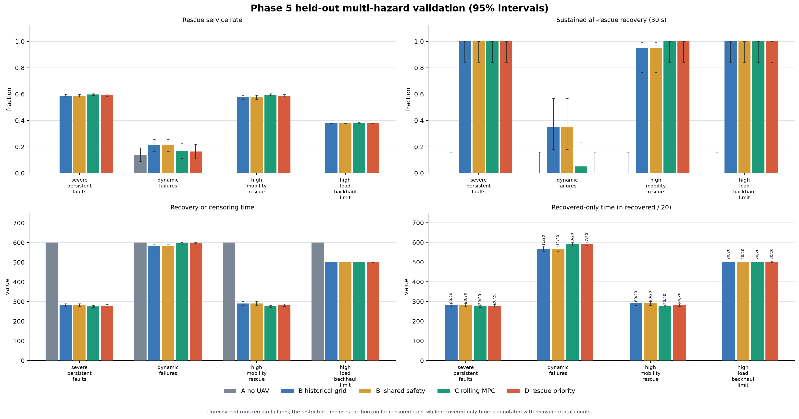
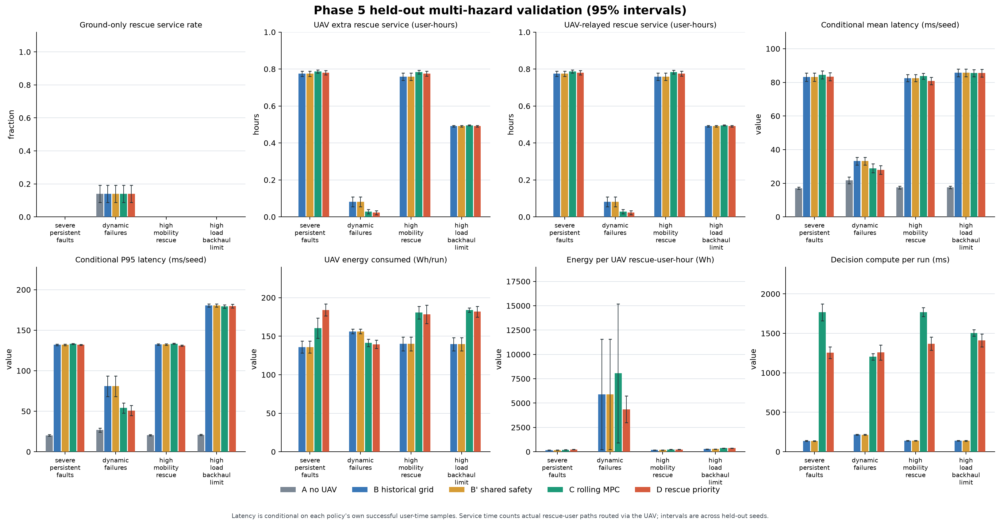

# 第五阶段报告：多灾害场景鲁棒性与自主自愈验证

## 结论摘要

本阶段在同一抽象城区、同一随机种子生成的用户轨迹和相同执行层飞行/电量约束下，比较 A、B、B′、C、D 五种策略。最终留出验证覆盖 4 类灾害、每类 20 个未参与调参的种子，共 80 个种子、400 次策略运行。结果没有显示滚动优化在所有场景中都优于静态规则：D 在严重持续故障和高移动性场景取得小幅、配对区间不跨零的救援服务率增益；在动态故障场景显著落后；在高负载场景与 B 基本相同。C 的表现也呈场景依赖，并支付更高的计算和能耗成本。

在“无自动维修”场景中，无人机能在**至少保留一个健康地面基站作为回传锚点**时恢复救援通信：A 为 0/20 次全体救援用户恢复，B/B′/C/D 均为 20/20 次首次全恢复和 20/20 次持续 30 秒恢复。该配置的平均救援用户服务率仍约为 59%，表示仿真期间的救援用户时间样本中约 59% 获得服务，不等于城市恢复到全覆盖。若没有健康回传基站，系统记录不可行原因并停止中继；单无人机不能自行创建回传链路。

## 1. 场景与复现实验

四类场景均使用 `configs/phase5/` 中的独立 TOML 配置。城区为 10×10 km、40 个用户（32 个普通用户、8 个救援用户）、1 架无人机，模拟 600 秒、每 10 秒一步。无人机最大速度为 0.015 km/s（每步最多 0.15 km），接入半径 2.6 km、回传半径 4.5 km；基站额定容量 50 Mbps、无人机回传额定容量 40 Mbps。各策略共享同种子的逐步用户轨迹和外生事件序列。

| 场景 | 事件与边界 | 开发种子 | 留出验证种子 |
|---|---|---:|---:|
| 严重持续故障 | 初始 3 个基站中 2 个失效，剩余 1 个健康；没有基站恢复事件 | 6500–6504 | 7000–7019 |
| 动态故障 | 120s 西侧基站故障；180s 无人机回传中断；220s 中央基站故障；260s 回传恢复；320s/400s 分别安排西侧/中央基站维修 | 6510–6514 | 7020–7039 |
| 高移动救援 | 救援用户按有界、带种子的随机游走移动；120s 将每坐标轴移动上限提高至 0.06 km/步，420s 降至 0.025 km/步 | 6520–6524 | 7040–7059 |
| 高负载/回传受限 | 城市负载 100s 增至 1.15 倍；救援需求 180s 增至 1.8 倍；回传容量从 40 降至 24 Mbps，320s 升至 36 Mbps；480s/500s 恢复业务负载 | 6530–6534 | 7060–7079 |

严重持续故障场景不包含任何预设地面维修；动态故障场景中的维修是显式定时事件，不是系统自动恢复。随机游走、故障、维修、负载变化和回传变化都写入逐种子结果并带时间戳。

初版 Phase 5 动态配置出现“仿真初始时刻救援用户已全部连接”的场景定义缺陷，其试验完整保存在 `results/phase5_v1/`，未用于本文结论。随后调整救援用户起始区域，并以全新种子完成 v2 冻结验证。冻结清单 SHA-256：

```text
386be3c58f822e326d7283451bcc00c1d2c710c60240c65f5231968c8aa5b6d5
```

配置和算法源文件哈希、种子表及协议保存在 `results/phase5_frozen_manifest.json`。最终逐种子数据为：

- `results/phase5_validation_severe_persistent_faults.json`
- `results/phase5_validation_dynamic_failures.json`
- `results/phase5_validation_high_mobility_rescue.json`
- `results/phase5_validation_high_load_backhaul_limit.json`
- 汇总：`results/phase5_validation_summary.json`
- 便于筛查的故障与恢复事件索引：`results/phase5_failure_cases.json`

完整时间戳事件仍保留在四个逐种子结果文件中。

## 2. 策略与统一约束

- **A 无人机恢复关闭**：只执行网络中显式安排的基站/链路事件，不调度无人机。动态故障场景中它仍可能获得地面网络的部分救援用户服务。
- **B 历史静态网格策略**：仿真初始时进行一次网格选址，后续不因新状态改选目标。保留为第一阶段历史基线。
- **B′ 共享安全约束的静态网格**：沿用 B 的同一初始网格目标，但增加规划侧完整 sortie 能量预算，用于公平比较。B 和 B′ 的执行层速度、电量和返航安全检查相同。
- **C 滚动时域候选搜索**：有限时域 beam search，对候选移动序列累计救援服务、普通连接、全体救援恢复奖励、时延、能耗和朝救援区的进展；执行首个动作后，根据状态变化或周期重新规划。它是确定性优化，不是训练所得的机器学习模型。
- **D 救援优先滚动优化**：候选点和短时域轨迹按词典序比较：救援用户时隙服务数、是否可在时域内全恢复、预测恢复时间、目标点救援连接数、时域末端救援数、进展、普通用户服务、时延、sortie 能耗、目标距离和切换惩罚。初始参考点保留 B 的静态网格目标作为稳定锚点；后续只有救援服务层级改善时才切换目标。

四种有无人机的策略共用执行层安全边界：电量不得低于 50 Wh 保护储备；移动能耗 18 Wh/km；悬停功率 80 W；中继功率 120 W；每步受 0.15 km 速度限制，位置不得越出 10×10 km 城区；无人机中继必须有可用回传，并满足接入/回传覆盖和容量限制。规划能量统一使用 Wh：移动距离乘 Wh/km，悬停和中继功率乘时间并除以 3600。规划侧还需保留足够能量返航，不能只检查剩余电量。

B′ 与 B 在所有 80 个配对种子的救援服务、时延、能耗和恢复结局完全一致，说明本组参数下 B 的目标没有触发新增 sortie 安全预算的拒绝条件。B′ 用于显示公平约束没有人为削弱规则基线，但没有造成可测行为差异。

## 3. 指标与统计口径

1. 救援服务率按整个仿真期间的“救援用户-时间步”统计，反映服务持续度，不是一次连通概率。
2. 首次恢复定义为一个观测时刻所有救援用户同时连接；持续恢复要求这种状态连续维持 30 秒。两者分别报告。
3. 未恢复运行的 `network_recovery_time_s` 保留为 `null`，并计入失败数。另报告每个失败运行以 600 秒仿真时长代入后的全样本恢复/截尾上界均值；它不是 Kaplan–Meier 生存分析估计。
4. 救援率、能耗、单位服务能耗和控制器耗时区间为每种子的均值 95% Student-t 区间；配对策略差使用相同种子内的差值及 Student-t 区间。恢复比例使用 Wilson 区间。表中的时延是每个种子内成功连接样本的均值/95 分位数，再对种子求均值；时延仅对各策略已连通样本计算，样本集合不一致，因此只作条件描述，不作为配对因果结论。完整 JSON 保存各连续指标的均值、中位数、标准差、区间和样本数。
5. 无人机救援服务小时是实际采用 `drone_relay` 路径的救援用户秒数除以 3600（单位为“用户小时”，不是无人机飞行小时）。单位服务能耗为该种子无人机总能耗除以实际中继救援用户小时；零服务运行时记为 `null`。
6. 计算耗时使用相同 `perf_counter` 边界包围 `controller.observe`，报告完整运行所有观察/决策调用的累计耗时 `controller_observe_total_ms`。它是本机软件仿真耗时，不等价于机载硬件实时性能。

## 4. 留出验证结果

### 救援服务和恢复

“成功运行恢复均值”仅对首次全恢复成功运行计算；“全样本恢复/截尾上界均值”将未恢复运行按 600 秒计入。未恢复数量可由 20 减去首次恢复数量得到。

| 场景 | 策略 | 救援服务率 %（95%CI） | 首次全恢复 | 持续 30s | 成功运行恢复均值 s | 全样本恢复/截尾上界均值 s |
|---|---|---:|---:|---:|---:|---:|
| 严重持续故障 | A | 0.00 [0.00, 0.00] | 0/20 | 0/20 | — | 600.0 |
| 严重持续故障 | B / B′ | 58.82 [57.77, 59.87] | 20/20 | 20/20 | 281.5 | 281.5 |
| 严重持续故障 | C | 59.62 [59.01, 60.24] | 20/20 | 20/20 | 275.5 | 275.5 |
| 严重持续故障 | D | 59.17 [58.32, 60.02] | 20/20 | 20/20 | 278.5 | 278.5 |
| 动态故障 | A | 14.00 [8.79, 19.20] | 0/20 | 0/20 | — | 600.0 |
| 动态故障 | B / B′ | 21.11 [16.52, 25.69] | 11/20 | 7/20 | 568.2 | 582.5 |
| 动态故障 | C | 16.83 [11.28, 22.39] | 8/20 | 1/20 | 590.0 | 596.0 |
| 动态故障 | D | 16.31 [10.78, 21.85] | 7/20 | 0/20 | 590.0 | 596.5 |
| 高移动救援 | A | 0.00 [0.00, 0.00] | 0/20 | 0/20 | — | 600.0 |
| 高移动救援 | B / B′ | 57.59 [56.06, 59.13] | 20/20 | 19/20 | 290.5 | 290.5 |
| 高移动救援 | C | 59.45 [58.72, 60.17] | 20/20 | 20/20 | 276.5 | 276.5 |
| 高移动救援 | D | 58.83 [57.90, 59.77] | 20/20 | 20/20 | 282.0 | 282.0 |
| 高负载/回传受限 | A | 0.00 [0.00, 0.00] | 0/20 | 0/20 | — | 600.0 |
| 高负载/回传受限 | B / B′ | 37.86 [37.58, 38.14] | 20/20 | 20/20 | 500.0 | 500.0 |
| 高负载/回传受限 | C | 38.19 [38.02, 38.36] | 20/20 | 20/20 | 500.0 | 500.0 |
| 高负载/回传受限 | D | 37.85 [37.53, 38.16] | 20/20 | 20/20 | 500.5 | 500.5 |

### 与静态网格 B 的配对救援服务率差

差值单位为百分点，区间基于同一种子配对差；B′ 与 B 的服务结果完全相同。

| 场景 | C − B（95%CI） | D − B（95%CI） | 解释 |
|---|---:|---:|---|
| 严重持续故障 | +0.799 [+0.136, +1.463] | +0.348 [+0.055, +0.642] | D 有小幅增益；C 更高 |
| 动态故障 | −4.272 [−6.902, −1.643] | −4.795 [−7.399, −2.192] | C/D 均低于 B；B 持续恢复 7/20，D 为 0/20 |
| 高移动救援 | +1.854 [+0.475, +3.234] | +1.240 [+0.192, +2.287] | C/D 有小幅增益，均有 20/20 首次恢复 |
| 高负载/回传受限 | +0.328 [+0.156, +0.499] | −0.010 [−0.083, +0.063] | C 增益很小；D 与 B 无可辨差异 |

这些是四种预设场景上的配对模拟差，不是对现实网络总体的置信结论。场景/指标的多重比较未作校正，因此结果作为探索性证据解释，不宣称普遍显著性。

### 能耗、无人机服务与计算成本

下表单位能耗是逐种子比值的均值；控制器耗时为完整 600 秒运行中累计的 `controller.observe` wall-clock 时间。平均/P95 时延是成功连接样本的条件均值，`n` 是汇总原始成功用户-时间样本数。

| 场景 | 策略 | 平均 / P95 时延 ms（样本 n） | UAV 救援服务用户小时 | 能耗 Wh（95%CI） | Wh/服务用户小时（95%CI） | 控制器耗时 ms（95%CI） |
|---|---|---:|---:|---:|---:|---:|
| 严重持续故障 | A | 17.05 / 20.16（8,798） | 0 | 0 | — | 0.07 [0.07, 0.08] |
| 严重持续故障 | B | 83.15 / 131.99（19,135） | 0.7751 | 135.88 [128.06, 143.71] | 175.45 [165.25, 185.64] | 138.56 [133.87, 143.25] |
| 严重持续故障 | B′ | 83.15 / 131.99（19,135） | 0.7751 | 135.88 [128.06, 143.71] | 175.45 [165.25, 185.64] | 137.63 [133.27, 142.00] |
| 严重持续故障 | C | 84.53 / 133.14（19,322） | 0.7863 | 160.39 [147.31, 173.48] | 204.17 [187.27, 221.08] | 1,766.88 [1,661.14, 1,872.61] |
| 严重持续故障 | D | 83.40 / 132.03（19,178） | 0.7799 | 184.14 [176.40, 191.87] | 236.44 [225.49, 247.39] | 1,255.89 [1,182.77, 1,329.01] |
| 动态故障 | A | 21.75 / 26.80（13,972） | 0 | 0 | — | 0.07 [0.07, 0.07] |
| 动态故障 | B | 33.16 / 80.91（17,733） | 0.0817 | 156.17 [153.17, 159.17] | 5,894.01 [223.10, 11,564.92] | 217.00 [210.47, 223.54] |
| 动态故障 | B′ | 33.16 / 80.91（17,733） | 0.0817 | 156.17 [153.17, 159.17] | 5,894.01 [223.10, 11,564.92] | 215.98 [209.33, 222.63] |
| 动态故障 | C | 28.89 / 54.05（17,238） | 0.0285 | 141.34 [136.65, 146.03] | 8,054.91 [922.59, 15,187.22] | 1,203.08 [1,163.66, 1,242.49] |
| 动态故障 | D | 27.91 / 50.90（16,945） | 0.0228 | 139.45 [134.11, 144.79] | 4,358.69 [2,989.86, 5,727.51] | 1,257.96 [1,162.25, 1,353.68] |
| 高移动救援 | A | 17.48 / 20.59（8,809） | 0 | 0 | — | 0.07 [0.07, 0.07] |
| 高移动救援 | B | 82.51 / 132.42（18,928） | 0.7589 | 139.99 [131.14, 148.83] | 185.28 [171.71, 198.85] | 140.98 [136.85, 145.12] |
| 高移动救援 | B′ | 82.51 / 132.42（18,928） | 0.7589 | 139.99 [131.14, 148.83] | 185.28 [171.71, 198.85] | 139.91 [135.77, 144.05] |
| 高移动救援 | C | 83.67 / 133.48（19,044） | 0.7836 | 180.62 [172.52, 188.72] | 230.73 [219.79, 241.67] | 1,769.94 [1,715.28, 1,824.61] |
| 高移动救援 | D | 80.83 / 130.94（18,536） | 0.7753 | 178.37 [166.56, 190.19] | 230.58 [214.19, 246.97] | 1,369.76 [1,287.09, 1,452.42] |
| 高负载/回传受限 | A | 17.58 / 20.78（8,381） | 0 | 0 | — | 0.07 [0.07, 0.08] |
| 高负载/回传受限 | B | 85.69 / 180.66（14,840） | 0.4910 | 139.66 [131.16, 148.17] | 284.47 [267.20, 301.75] | 140.04 [135.80, 144.29] |
| 高负载/回传受限 | B′ | 85.69 / 180.66（14,840） | 0.4910 | 139.66 [131.16, 148.17] | 284.47 [267.20, 301.75] | 139.04 [134.64, 143.44] |
| 高负载/回传受限 | C | 85.50 / 179.34（14,968） | 0.4954 | 183.88 [181.02, 186.74] | 371.18 [365.41, 376.95] | 1,505.40 [1,463.54, 1,547.25] |
| 高负载/回传受限 | D | 85.49 / 179.93（14,842） | 0.4908 | 181.76 [174.95, 188.58] | 370.41 [356.44, 384.39] | 1,412.14 [1,330.07, 1,494.21] |

## 5. 结果解释与适用边界

### 无地面自动维修时无人机能否恢复救援通信？

在严重持续故障配置中可以：2 个基站持续失效、无维修事件，仍有 1 个健康基站作为回传锚点。A 无法让救援用户连接；B/B′/C/D 均在 20/20 留出运行中达到首次全救援连接和 30 秒持续恢复，首恢均值约 276–282 秒。按同一时间步关闭无人机的地面对照，救援服务率为 0%，恢复事件均标为 `uav_assisted`。如果所有基站都失效或不存在回传路径，则无法自主恢复端到端通信；动态故障运行中 D 确实遇到这种情况并报告不可行。

### 哪些场景优化策略优于静态网格？

D 的配对救援服务率比 B 高约 0.35 个百分点（严重持续故障）和 1.24 个百分点（高移动救援），两项 95% 配对区间均不跨 0，但需要更多能量和约 1.26–1.41 秒/次运行的控制器耗时，B 约 0.14–0.22 秒。严重故障中 D 的服务增益很小，能耗从 B 的 135.88 Wh 增至 184.14 Wh；高移动场景从 139.99 Wh 增至 178.37 Wh。这属于可复现但代价明显的场景性增益，不是成本效益全面改进。

C 在高负载场景比 B 高约 0.33 个百分点，95% 区间不跨 0，但平均能耗多约 44.22 Wh、完整运行控制器耗时约 1.51 秒（B 约 0.14 秒）。D 在高负载时救援服务率与 B 无法区分，能耗更高。若研究目标是救援服务优先且允许较高调度成本，C 在本高负载设置值得继续研究；不能据此宣称 D 更适合高负载。

### 为什么 C/D 在动态故障场景落后？

验证配置具有基站故障、无人机回传中断、全站失效窗口以及随后定时维修。B 在 11/20 次达到首次全救援连接、7/20 次持续 30 秒；C 分别 8/20、1/20；D 分别 7/20、0/20。配对救援服务差为 C−B −4.27pp、D−B −4.80pp，两个区间均低于 0。D 平均每次运行重规划 18.7 次并切换目标 2.15 次；B 不切换初始目标。

事件窗口、动态状态估计与 D 的初始静态参考点锚定可能解释这种差异，但本实验没有做因果消融来分离“重规划时机、静态初始目标、维修时序”各自的影响。算法不能因为少用能量就被判为更优：C/D 在动态故障中能耗较低，但无人机实际救援中继用户小时也显著减少，救援服务和持续恢复更差。

### 能否稳定复现救援服务增益？

能在两个预设场景中复现小幅正增益，不能跨场景复现为普遍优势。严重持续故障和高移动救援的 D−B 配对区间分别为 [+0.055,+0.642]pp 和 [+0.192,+2.287]pp；动态故障为 [−7.399,−2.192]pp；高负载为 [−0.083,+0.063]pp。场景只有四类且未对多重比较校正，仍需更多场景与参数外验证。

## 6. 安全退出、测试与限制

规划不可行时会设置 `deploy=false` 并记录原因，包括 `no_healthy_base_station`、`drone_backhaul_temporarily_unavailable`、`full_target_sortie_energy_would_violate_reserve`、`return_energy_reserve_would_be_violated` 和 `no_backhaul_preserving_route_to_target`。动态故障留出日志中实际出现“回传暂不可用”和“无健康基站”；`results/phase5_failure_cases.json` 汇总未达首次/持续恢复判据的 147 条运行记录、故障时间线、安全退出决定和对应原始文件。完整事件日志保存在四个逐种子结果 JSON。

`scripts/phase5_audit.py` 对留出结果执行数据、时间戳、种子隔离和能量安全核验。审计通过：80 个留出种子、400 次策略运行；开发/验证种子交集为零；最大移动距离/速度上限比为 1.0；最低实测电量为 404.667 Wh，高于 50 Wh 储备线；规划 sortie 最小储备余量为 241.617 Wh；事件日志能耗与汇总最大误差低于 0.000001 Wh；B/B′服务、能耗和恢复结局一致。详细审计结果在 `results/phase5_integrity_audit.json`。

验证结果：`uv run pytest -q` 为 **26 passed**；`frontend/npm run build` 成功，TypeScript 检查通过；前端构建有 ECharts 分包 533.66 kB 的 Vite 提示（提示阈值 500 kB）。本地 HTTP 冒烟检查中 `/api/health`、原 Phase 2 API、Phase 5 汇总和单场景 API 均返回 HTTP 200。第三阶段 React 页面没有被修改；旧回放和历史 Phase 2–4 JSON 均保留。

当前限制：

- 这是城市 2D 覆盖、容量/回传/时延/能耗的抽象离散仿真；不模拟真实 6G 空口、建筑遮挡、干扰协调、协议栈或实地无人机飞控。
- 无健康回传站时没有路径供无人机中继。策略会停止服务并解释原因；当前模型没有真实备降场/返航航路、失联后的物理迫降验证，也不完整模拟中继关闭后的悬停/返航能耗，因此软件电量保护不等于航空安全。
- 用户随机游走和业务模型较简单，单机、单区域、40 用户规模有限；没有用真实灾害数据拟合，也没有评估配置外分布。
- D 初始以 B 的静态网格点作为稳定锚点；当前算法频率和候选集合只在开发种子上设定。C/D 计算耗时是本机仿真时间，不代表机载实时能力。
- 高负载场景 C 增益约 0.33pp，D 无可辨增益；动态场景 B 更稳。当前证据适合支持“有约束的单无人机自主调度及适用边界研究”，不适合支持“AI 普遍优于规则策略”“已训练 AI”或“真实 6G 测试”等主张。

## 7. 复现命令与图表

在项目根目录运行：

```bash
uv run pytest -q
uv run lowalt6g run-phase5 --phase development
uv run lowalt6g run-phase5 --phase validation
uv run python scripts/phase5_audit.py
uv run python scripts/phase5_summary.py --phase validation
```

验证阶段会检查 `results/phase5_frozen_manifest.json` 与现有算法/配置是否一致。若调整算法或场景，应使用新的开发与留出种子、重新冻结并执行验证，不得将本文留出结果用于反复调参。图表：

- `plots/phase5_reliability.png` / `.svg`
- `plots/phase5_service_and_cost.png` / `.svg`





## 8. 工程交付情况

开发分支为 `phase5-multihazard-robustness`。本工作区启动时已有第三/四阶段文件和结果处于未提交状态；本阶段保留这些文件，未清理、回退或覆盖历史内容，也未将混合的既有改动打包提交。第三阶段页面及旧 API schema 未改动，Phase 5 API 是加法扩展。
